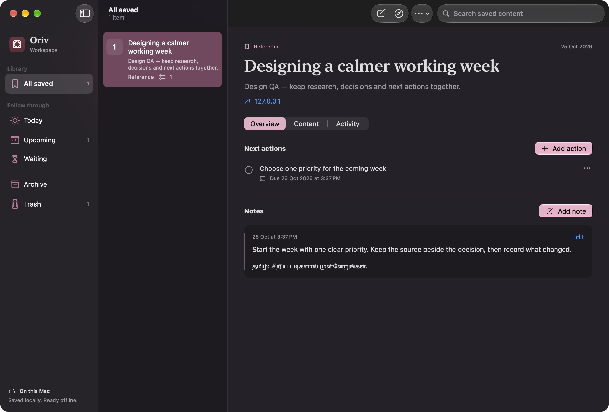

# Oriv

A native Mac browser foundation built with SwiftUI and Apple's system WebKit. The domain and browser-engine packages support iOS, so the future iPhone app can reuse the same state, privacy rules and navigation behavior. The Xcode project and bundle identifier retain their original PersonalBrowser names to preserve existing sessions and website data.

Open source under the [MIT license](LICENSE). See [contributing](CONTRIBUTING.md) and [dependencies and asset provenance](THIRD_PARTY_NOTICES.md).



## Personal Mac release

**Oriv 0.5.0 (build 5)** was packaged and verified on the development Mac. It supports Apple silicon and Intel Macs running macOS 26 or later. This repository publishes the source; local DMGs and app bundles are excluded. Running the packaging script creates `build/releases/Oriv-0.5.0-macOS.dmg`. This optimized Release build is ad-hoc signed with hardened runtime; it is **not Developer ID signed or notarized**. See [release verification and screenshots](docs/releases/0.5.0.md).

Rebuild the universal app and verified DMG with `./scripts/package-mac.sh`. Set `ORIV_SIGNING_IDENTITY` only when an appropriate signing identity is configured; the script does not perform notarization.

## Run on Mac

Requirements: macOS 26 or later and Xcode 26 or later with Swift 6. This checkout was developed with Xcode 27. No third-party runtime dependencies or provider accounts are required.

Open `PersonalBrowser.xcodeproj`, choose the **PersonalBrowser** scheme and **My Mac**, then Run. The project uses local ad-hoc signing for development; no Apple development team is configured.

From the terminal:

```sh
./scripts/run-mac.sh
```

`project.yml` is the XcodeGen source of truth. The generated Xcode project is included, so XcodeGen is only needed when changing targets or project configuration. Regenerate with `xcodegen generate` after adding source files.

## Included

- Redesigned native start page with editable search, local tab/bookmark/history suggestions, favorite launchers and recent pages.
- Searchable sidebar with separate private tabs, adaptive toolbar and a native library sidebar.
- System/light/dark appearance settings (Command-comma), semantic colors and visible keyboard focus.
- Native sidebar tabs, new/close/duplicate/reopen tab commands.
- Address and DuckDuckGo search entry; back, forward, reload and stop.
- Per-tab live WebKit state, navigation progress, title and hostname.
- Restored background tabs load on selection rather than all at launch.
- Session restoration with atomic writes and a last-valid-session backup.
- Private tabs with a separate ephemeral website data store, excluded from saved tabs, history, bookmarks and reopen history.
- Contextual bookmarks with previewed on-device text capture, selected passages, immutable snapshots and a purpose note.
- Independent Workspace window with notes and revision history, next actions, completion/reopening, due dates and native local reminders.
- Content search, Today/Upcoming/Waiting views, Archive and recoverable Trash; one-time legacy bookmark migration.
- Native in-page Passwords field-menu flow, with toolbar and Settings guidance. No vault import or JavaScript credential bridge; see [setup and limits](docs/passwords.md).
- A bounded recent-history list with clear-history support.
- File downloads with destination selection, cancellation and Finder reveal.
- Native website alerts, confirmations, prompts, file selection and new-tab links.
- Find in page, zoom, light/dark system appearance and keyboard shortcuts.
- Visible navigation failures and website-process recovery by reloading.
- Shared fullscreen/AirPlay configuration, iPhone inline/PiP preparation, audio autoplay protection and idle-view throttling.
- App, operating-system and WebKit build information in Settings.
- Safari-compatible identification for sites such as YouTube live chat, while retaining the system WebKit engine.
- A frame-based AppKit host that lets WebKit move the player into its fullscreen window and restore it safely.
- A subtle kolam-inspired vector identity using Apple's Icon Composer, with default, dark and tinted appearances.
- Built-in WebKit ad blocking with Off, Balanced and Strict modes in normal and private tabs. Regular site exceptions persist; private exceptions are forgotten when the last private tab closes. See [filter coverage and controls](docs/ad-blocking.md).

## Keyboard shortcuts

| Action | Shortcut |
| --- | --- |
| Address/search | Command-L |
| New tab | Command-T |
| Private tab | Command-Shift-N |
| Close tab | Command-W |
| Reopen closed tab | Command-Shift-T |
| Back / Forward | Command-[ / Command-] |
| Previous / Next tab | Command-Shift-[ / Command-Shift-] |
| Reload / Stop | Command-R / Command-. |
| Save page with context | Command-D |
| Workspace | Command-Shift-B |
| Find in page | Command-F |
| Zoom | Command-+ / Command-- / Command-0 |

## Architecture

```text
Apps/macOS/                 SwiftUI desktop UI, AppKit dialogs and downloads
Packages/BrowserKit/
  Sources/BrowserCore/       Portable records, address parsing and session files
  Sources/BrowserEngine/     Observable WebKit tabs, browser session and page capture
  Sources/ProductivityKit/   Shared workspace records, Core Data and local reminders
  Tests/BrowserCoreTests/    Address safety and persistence tests
Tests/BrowserMacTests/       Real WebKit integration tests
scripts/qa-server.py         Loopback-only fixture website
docs/                       Design, architecture and verification notes
```

The Mac target wraps `WKWebView` with `NSViewRepresentable`. `WKWebView` was chosen for mature navigation, download, popup and UI-delegate control; the application interface remains native SwiftUI. The iPhone target will provide a `UIViewRepresentable` and mobile dialog/file adapters. None of the shared modules imports AppKit. See [Workspace usage and architecture](docs/workspace.md) for the productivity layer and sync boundaries.

## Data and privacy

Session data is stored under the app's sandbox Application Support directory in `PersonalBrowser/session.json`. A backup sits alongside it. Both files use owner-only permissions. WebKit owns website cookies/cache separately. Pages are only contacted when opened; this build sends no page content to an AI provider and has no telemetry.

If both saved session files are unreadable, the app displays a notice and pauses saving instead of overwriting them. Newer session formats are also protected. Clearing history removes the previous session backup containing that history. Private tabs can still make network requests and explicitly save downloads; private browsing is not network anonymity.

Only tabs' URLs/titles and library entries are restored across launches. Unsaved website forms and complete back/forward stacks are retained while tabs are open, not across app termination. Downloads and private tabs are not resumed after quitting.

## Verify

```sh
swift test --package-path Packages/BrowserKit
swift scripts/generate-media-fixtures.swift build/media-fixtures
python3 scripts/qa-server.py
# In a second terminal, with the fixture running:
xcodebuild -project PersonalBrowser.xcodeproj -scheme PersonalBrowser \
  -destination 'platform=macOS' -derivedDataPath build/DerivedData test
```

Use `http://127.0.0.1:8768/one` for interactive navigation, form, popup, dialog, upload and download checks. The server binds to loopback and stores no submitted data.

Use `/media` for local video, captions, seeking, fullscreen, PiP and codec checks. Media rendering needs an unlocked, visible desktop session. See [version policy, media configuration and compatibility limits](docs/media-compatibility.md).

### Earlier 0.3.0 release verification on 25 October 2026

- Universal Release build, DMG integrity, strict app signature and installation from that DMG passed. The running process was verified at `/Applications/Oriv.app/Contents/MacOS/Oriv`.
- Eight core tests passed. The full native integration run had fifteen passes, three visibility-dependent skips and no failures; the final six blocker/popup checks also passed after the popup initialization safeguard.
- Installed-release normal-window fullscreen passed two entry/exit cycles with a local playing-video/chat fixture, restoring the original 1025 × 768 viewport each time. YouTube also passed two fullscreen entry/exit cycles from normal windows with Balanced filtering, visible video and working live chat. Escape restored the browser layout.
- The shared package compiled for the iPhone simulator. This is portability verification, not an implemented iPhone interface.

Details, evidence and known limits are in the [0.3.0 release report](docs/releases/0.3.0.md). Earlier verification remains in the [0.2.0 report](docs/releases/0.2.0.md).

### Earlier foundation and media checks on 25 October 2026

- Mac Debug build and local code-signature verification passed on macOS 27.0.1 / Xcode 27.0.
- Eight core tests passed for URL interpretation, snapshot validation and recovery.
- Nine integration tests passed in the initial full run; two rendered-playback tests initially skipped for window occlusion both passed in a targeted foreground rerun. H.264/HEVC frames, seeking, captions, speed and media-view preservation are verified.
- The Intel Mac target also builds successfully; this is compile verification, not an Intel hardware test.
- Both shared modules compile for the arm64 iPhone Simulator SDK, targeting iOS 26. This does not verify an iPhone app or device UI.
- Interactive Mac checks confirmed the start page, fixture website rendering, quit/relaunch session restoration and a native Save dialog producing the expected downloaded file.
- Interactive media checks confirmed H.264, HEVC, captions, tab-state preservation, video fullscreen enter/exit and Apple's HLS sample adapting to 1080p. Mac PiP requests returned `NotSupportedError`; AirPlay receiver and DRM-service checks remain pending.

The redesign was inspected in the running Mac app in light and dark appearances, including a narrow window and compact-height layout. Command-L selection, Escape restoration, new-tab focus, real HTTPS browsing, local tab filtering, private search isolation, library search/no-results, library dismissal and immediate closed-tab reopening were checked interactively. Native Save-panel download verification is retained from the foundation pass. Upload/JavaScript dialog checks and external authenticated-site compatibility remain pending.

See [design direction and Apple references](docs/design-direction.md), actual app screenshots (`docs/qa/redesign/`, local QA artifact) and the [media compatibility audit](docs/media-compatibility.md). Full-run results are in `build/MediaFinalTests.xcresult`, with the successful rendering rerun in `build/ForegroundMediaTests.xcresult`; local logs are ignored by Git. Complete VoiceOver/Full Keyboard Access, Increase Contrast and Reduce Transparency audits remain release checks; this is not a claim of Apple certification or complete accessibility conformance.

## Next milestones

1. Add the iPhone workspace interface and validate it on a physical device.
2. Add explicit iCloud sync with account-change, conflict and deletion handling.
3. Integrate Apple Calendar / Reminders through EventKit and configure Sign in with Apple if needed.
4. Add an on-device-first agent interface with selected-tab context and bounded browser tools.
5. Pursue supported browser credential integration and Apple passkey entitlements.

The implemented Mac workspace, privacy boundaries and native reminder behavior are described in [Workspace](docs/workspace.md), with verification in the [0.5.0 report](docs/releases/0.5.0.md).

The iPhone app, AI agents, sync, multiple profile UI, tab suspension, Safari-style automatic password suggestions and extension hosting are not implemented. The personal Release package is not a notarized distribution or App Store release. Default-browser, passkey, media-permission and authenticated-site compatibility require dedicated release testing and applicable Apple entitlements.

The 0.5 design system and inspiration references are documented in [Oriv design system](docs/design-system.md).

Raw QA captures and build logs referenced here are retained locally and excluded from the public repository. Published synthetic-content screenshots are in `docs/images/`.
